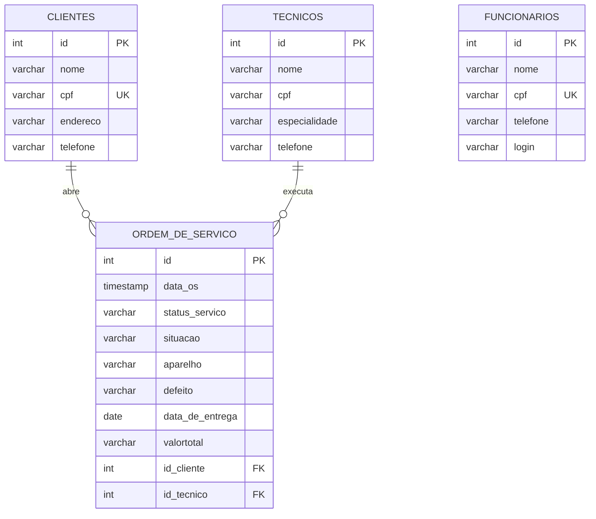

<div align="center">

# 🔧 OrdemTech

**Sistema de ordens de serviço para uma empresa fictícia de reparo de aparelhos eletrônicos**


</div>

---

## 📖 Sobre o projeto

O **OrdemTech** foi o TCC do curso técnico em Desenvolvimento de Sistemas do SENAI, desenvolvido em equipe. A ideia foi criar uma solução completa para uma empresa fictícia de reparo de aparelhos eletrônicos, unindo a presença da empresa na internet com o controle interno dos serviços.

O sistema é dividido em quatro partes que conversam com o mesmo banco de dados:

| Parte | O que faz | Tecnologias |
|---|---|---|
| 🖥️ **Sistema desktop** | Usado pelos funcionários: login por CPF e senha, cadastro de clientes, técnicos e funcionários, abertura e acompanhamento das ordens de serviço e controle da situação financeira | Java (Swing), JDBC, Eclipse |
| ⚙️ **API REST** | Fornece os dados para o portal web (clientes, técnicos e ordens de serviço) | Java 21, Spring Boot 3, Spring Data JPA |
| 🌐 **Portal web** | Clientes e técnicos fazem login, se cadastram, redefinem a senha, consultam suas ordens de serviço e acessam a tela de pagamento com QR Code | HTML, CSS, JavaScript, Bootstrap |
| 🏠 **Site institucional** | Página de apresentação da empresa fictícia "OrdemTech Solutions" | HTML, CSS, JavaScript, Bootstrap |

Todas as partes conversam com o mesmo banco de dados MySQL. Na equipe, fiquei responsável pelo **layout e pela criação do banco de dados**, e o modelo está descrito logo abaixo.

## 🗄️ Banco de dados

O banco `projetotech` (MySQL) tem quatro tabelas. A tabela de ordens de serviço se relaciona com clientes e técnicos por chave estrangeira.



_Diagrama simplificado (sem as colunas de senha). O script completo está em [`bancodedados/schema.sql`](bancodedados/schema.sql)._

| Tabela | Para que serve |
|---|---|
| `clientes` | Quem leva o aparelho para consertar (CPF único) |
| `tecnicos` | Técnicos da empresa e suas especialidades |
| `funcionarios` | Quem usa o sistema desktop (acesso por CPF e senha) |
| `ordem_de_servico` | Cada serviço: aparelho, defeito, técnico, valor, situação e data de entrega |

## 🔌 Endpoints da API

Todos os caminhos começam com `/ordem`.

| Método | Rota | Função |
|---|---|---|
| GET | `/cliente/{id}` | Lista as ordens de serviço de um cliente |
| GET | `/cliente/cpf/{cpf}` | Busca um cliente pelo CPF |
| POST | `/cliente` | Cadastra um cliente |
| PUT | `/cliente/cpf/{cpf}` | Atualiza a senha do cliente |
| DELETE | `/cliente/{id}` | Exclui um cliente |
| GET | `/tecnico/{id}` | Lista as ordens de serviço de um técnico |
| GET | `/tecnico/cpf/{cpf}` | Busca um técnico pelo CPF |
| POST | `/tecnico` | Cadastra um técnico |
| PUT | `/tecnico/cpf/{cpf}` | Atualiza a senha do técnico |
| DELETE | `/tecnico/{id}` | Exclui um técnico |

## 📁 Estrutura de pastas

```
OrdemTech/
├── OrdemTech eclipse/   # Sistema desktop (Java Swing)
├── OrdemTech/           # API REST (Spring Boot, Maven)
├── login/               # Portal web de clientes e técnicos
├── PaginaInicial/       # Site institucional
├── assets/              # Estilos, scripts e imagens do site
├── bancodedados/        # Script SQL do banco
└── Index.html           # Página inicial do site
```

## ▶️ Como executar

**Pré-requisitos:** MySQL, JDK 21 e Eclipse (para o sistema desktop).

1. **Banco de dados:** execute o arquivo `bancodedados/schema.sql` no MySQL. Ele cria o banco `projetotech`, as tabelas e alguns dados fictícios para teste.
2. **Senha do banco:** troque `SUA_SENHA_AQUI` pela senha do seu MySQL em dois arquivos:
   - `OrdemTech/src/main/resources/application.properties` (API)
   - `OrdemTech eclipse/src/br/com/ordemtech/model/DAO.java` (sistema desktop)
3. **API:** dentro da pasta `OrdemTech`, rode `./mvnw spring-boot:run` (no Windows, `mvnw.cmd spring-boot:run`). Ela sobe em `http://localhost:8080`.
4. **Sistema desktop:** no Eclipse, importe a pasta `OrdemTech eclipse` (`File > Import > Existing Projects into Workspace`) e execute a classe `Login`. Para entrar, use o CPF e a senha do funcionário de teste do `schema.sql`.
5. **Portal web:** os scripts da pasta `login/js` chamam a API por um endereço de rede local. Troque `192.168.1.184` por `localhost` nesses arquivos e abra o `Index.html` no navegador.

## 🔭 Melhorias futuras

Olhando o projeto hoje, estes são os pontos que eu melhoraria, principalmente por causa do meu interesse em segurança:

- Guardar as senhas com hash (por exemplo, BCrypt) em vez de texto puro no banco
- Fazer a verificação de login no back-end, e não comparando a senha no JavaScript do navegador
- Tirar usuário e senha do banco de dentro do código e usar variáveis de ambiente
- Restringir o CORS da API e validar melhor os dados recebidos
- Criar endpoints para as ordens de serviço e adicionar testes automatizados

## 📚 O que eu aprendi

- Integrar front-end, back-end e banco de dados em um mesmo projeto
- Criar uma API REST com Spring Boot e consumi-la pelo navegador
- Trabalhar em equipe e dividir tarefas
- Modelar um banco relacional e organizar um sistema do zero, do planejamento à entrega

## 👥 Equipe

Projeto desenvolvido em grupo como TCC do curso técnico em Desenvolvimento de Sistemas do SENAI. Todos participaram da organização e da divisão de tarefas.

| Integrante | Responsabilidades |
|---|---|
| **Leonardo Cozer Salles** | Layout e criação do banco de dados |
| **Caio** | Criação da ordem de serviço (OS) |
| **Lucas** | Conexão entre Java e banco de dados e conexão com o servidor |
| **Emily** | Ideias de layout e desenvolvimento das páginas web, escrita da documentação |
| **Heloisa** | Ideias de layout e desenvolvimento das páginas web |
| **Juliana** | Ideias de layout e desenvolvimento das páginas web, escrita da documentação |

## 📫 Contato

[LinkedIn](https://www.linkedin.com/in/leonardo-cozer-salles) • [E-mail](mailto:leonardocsalles05@gmail.com)
